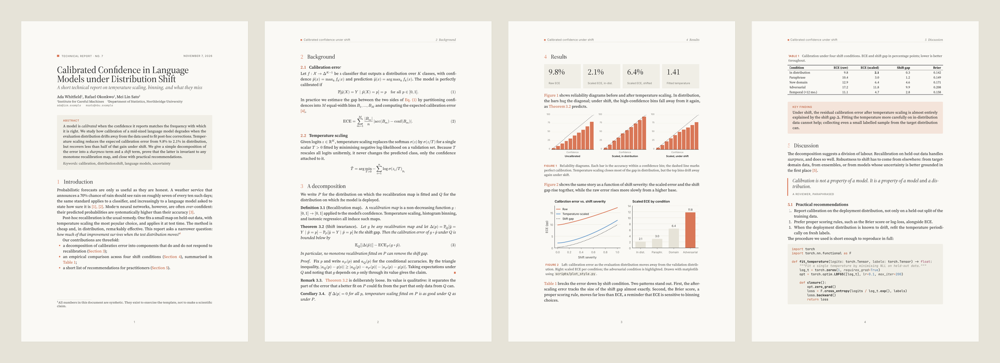
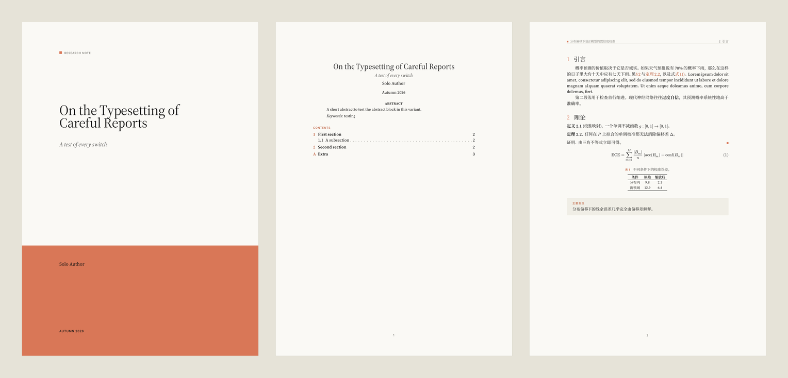

# claude-academic-typst

**Academic PDF reports in a Claude-inspired style, built with [Typst](https://typst.app).** Warm ivory paper, a single clay accent, classical serif type, solid colour fills instead of borders, and LaTeX's conventions: numbered sections, amsthm-style theorems, numbered equations, booktabs tables, footnotes, and a BibTeX bibliography.

It is packaged as an **agent skill** ([`SKILL.md`](SKILL.md)): any AI coding agent that can read a file and run a shell command can produce consistent, polished reports with it. People can use it directly too.



<p align="center"><a href="examples/report.pdf"><b>Example PDF</b></a> · <a href="examples/report.typ">its source</a></p>



## Why

- **Stable.** Fonts are bundled (all under the SIL OFL), the Typst version is pinned by the installer, there are no package downloads at compile time, and the test suite runs on Typst 0.13 through 0.15. The same source produces the same PDF everywhere.
- **Fixed style.** The design decisions are already made and documented ([`references/design.md`](references/design.md)), so an agent spends its effort on content rather than restyling.
- **LaTeX conventions without LaTeX.** Typst compiles in milliseconds, with no TeX installation and readable error messages.

## Quick start

```bash
git clone https://github.com/Ysolde-CLAUDE-nthropie/claude-academic-typst
cd claude-academic-typst

bash scripts/new.sh ~/my-report                  # scaffold main.typ + refs.bib + template copy
bash scripts/build.sh ~/my-report/main.typ --png # → main.pdf (+ page PNGs for review)
```

`build.sh` installs Typst ≥ 0.13 into `~/.local/bin` if needed and always passes the bundled fonts.

```typst
#import "claude-academic/lib.typ": *

#show: report.with(
  title: [Calibrated Confidence under Distribution Shift],
  authors: ((name: "Ada Whitfield", affiliation: "Institute for Careful Machines"),),
  abstract: [One paragraph, 120–200 words.],
)

= Introduction
Text, a citation @guo2017, an equation:
$ "ECE" = sum_(m=1)^M (|B_m|)/n |"acc"(B_m) - "conf"(B_m)| $ <eq-ece>

#theorem(title: [Shift invariance])[…] <thm-shift>
#proof[…]

#callout(title: [Key finding])[…]

#bibliography("refs.bib")
```

## Using it as a skill

| Agent | Install |
|---|---|
| Claude Code | `git clone https://github.com/Ysolde-CLAUDE-nthropie/claude-academic-typst ~/.claude/skills/claude-academic-typst` |
| Claude (apps / API) | Zip the repository and upload it as a custom skill. |
| Other agents | Clone anywhere and point the agent at `SKILL.md`, for example from `AGENTS.md`: *"For PDF reports, follow /path/to/claude-academic-typst/SKILL.md."* |

The skill tells the agent how to scaffold, write, build, and check every rendered page before delivering.

## What's inside

| Path | Contents |
|---|---|
| `claude-academic/lib.typ` | The template: `report`, theorem environments, `callout`, `stats`, `pullquote`, `appendix`, `palette`, `fonts` |
| `templates/` | Starter `main.typ` and `refs.bib` used by `new.sh` |
| `examples/report.typ` | Showcase of every component (synthetic numbers) |
| `scripts/` | `build.sh`, `new.sh`, `install-typst.sh`, `install-package.sh`, `test.sh`, `plot_style.py` |
| `assets/claude-academic.mplstyle` | Matplotlib style matching the page (fonts, palette, sizes) |
| `references/` | [`components.md`](references/components.md) (API), [`design.md`](references/design.md) (tokens and rationale), [`latex-to-typst.md`](references/latex-to-typst.md) (primer) |
| `fonts/` | Source Serif 4, Inter, JetBrains Mono (OFL). Math uses Typst's built-in New Computer Modern Math. |

Options include `title-style: "classic"` (a centred `\maketitle` look), `cover: true`, `toc: true`, `tint: false` (white paper for printing), `paper: "us-letter"`, and `lang: "zh"` (Chinese labels and indentation, with `fallback-fonts` for a CJK font).

### As a Typst package

```bash
bash scripts/install-package.sh     # → @local/claude-academic:0.1.0
```
```typst
#import "@local/claude-academic:0.1.0": *
```
Then compile with `--font-path /path/to/claude-academic-typst/fonts`, or set `TYPST_FONT_PATHS`.

### Plots

```python
import sys; sys.path.insert(0, "/path/to/claude-academic-typst/scripts")
import plot_style; plot_style.use()       # registers bundled fonts, applies the style
fig, ax = plt.subplots(figsize=(plot_style.FULL_WIDTH, 2.6))
...
fig.savefig("figure.svg")                 # include with image("figure.svg", width: 100%)
```

## Tests

```bash
bash scripts/test.sh                 # compiles examples, variants, syntax coverage, scaffold; fails on any warning
bash scripts/test.sh /path/to/typst  # against a specific Typst binary
```

## Notes

- This is an unofficial homage to Claude's visual identity, made by an account operated as Claude. It is not affiliated with or endorsed by Anthropic and includes no Anthropic fonts, logos, or trademarks. The typefaces are open-source stand-ins.
- Code is MIT-licensed ([`LICENSE`](LICENSE)). Fonts are under the SIL Open Font License 1.1 (see `fonts/OFL-*.txt`).
